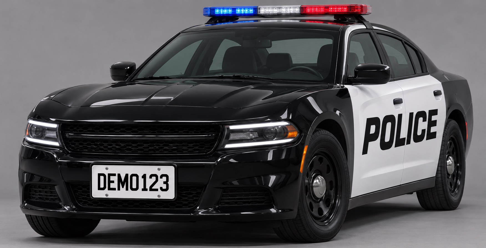

# Personal Flock Camera

I built a camera that could pick a marked police car out of a frame and try to read its plate. When two officers came to my door to ask about it, I told them I probably wouldn't release the code. I changed my mind. If a cheap camera can turn a passing car into something a computer can read, people on the other side of the lens should be able to see how that works. [Watch the original investigation](https://www.youtube.com/watch?v=ncCf00M7Axk)

This is the recognition part of that camera. You can run it on the fictional cruiser below and compare what the computer reads with what you see. One image is enough to try the whole thing on a laptop.



## Try the camera on one frame

Download the repository and open a terminal in its folder. The commands below use macOS or Linux shell syntax. The demo runs on CPU. Setup needs internet access and downloads about 610 MiB of model files, plus the Python packages. I tested these commands on an Apple Silicon Mac with Python 3.14. The download script requires Python 3.11 or newer.

```sh
python3 -m venv .venv
source .venv/bin/activate
python -m pip install -r requirements.txt
python download_models.py
python demo.py
```

The download script checks each file against its SHA-256 digest. Once setup finishes, you can disconnect and run the demo again. Here is the terminal output from the included image on the test Mac.

```text
Vehicle: truck
Marked-vehicle appearance score: 0.988
Plate region found.
Fictional plate read: DEM0123
```

Look at the bumper again. The plate says **DEMO123**, with the letter O. The reader printed **DEM0123**, with a zero. The first model also called the sedan a truck. Both mistakes made it all the way to the terminal on a clean, well-lit studio image.

## What the camera sees

1. **A vehicle.** YOLO11s looks for cars, buses and trucks. The demo takes the largest matching box in the image and crops it.
2. **Markings.** OpenCLIP compares that crop with text descriptions such as “a police cruiser,” “a taxi cab” and “a car with a roof rack.” It adds up the scores for the police descriptions. At 0.90 or higher, the demo tries to find a plate. A score of 0.90 doesn't mean nine out of ten such cars belong to a police department. The model is comparing appearances against a short list of descriptions.
3. **A plate-shaped region.** The YOLOv9 plate detector finds a small rectangle inside the vehicle crop. Finding that rectangle and reading the letters are separate jobs.
4. **Characters.** On the included example, Fast Plate OCR reads the pixels inside the rectangle.

To try the first three steps on a different image, use a staged JPEG or PNG you have permission to use. For example, take a photo of a toy car on a table and run the following command.

```sh
python demo.py my-toy-car.jpg
```

Try photographing the same toy from farther away. Does the vehicle still register? Does the markings score change? With your own image, the demo reports whether it found a plate region and stops before reading any characters.

## What happens to the image?

Detection runs locally, one still at a time. The program holds the pixels and predictions in memory and prints the result. It has no camera feed, GPS, map, sighting database, alerts or upload endpoint. The generated studio image above is the only image distributed with the source.

The distinction matters to the investigation. Reading one plate is already possible with a few public models. Keeping that read, attaching a time and place, and deciding who can search it are separate choices. This release lets you inspect the first part for yourself.

## Source and credits

The detection and scoring steps are in [demo.py](demo.py). The exact model files, upstream download addresses and checksums are in [download_models.py](download_models.py).

- [Ultralytics YOLO11](https://docs.ultralytics.com/models/yolo11/) finds the vehicle.
- [OpenCLIP](https://github.com/mlfoundations/open_clip) runs the [OpenAI CLIP ViT-B/32 weights](https://huggingface.co/timm/vit_base_patch32_clip_224.openai) to score the crop.
- [Open Image Models](https://github.com/ankandrew/open-image-models) supplies the YOLOv9 plate detector. [Fast Plate OCR](https://github.com/ankandrew/fast-plate-ocr) reads the fictional plate.

The source code in this repository is licensed under [AGPL-3.0-only](LICENSE). The dependencies and downloaded models retain their upstream licenses. This is an independent documentary project with no affiliation with Flock Safety.
